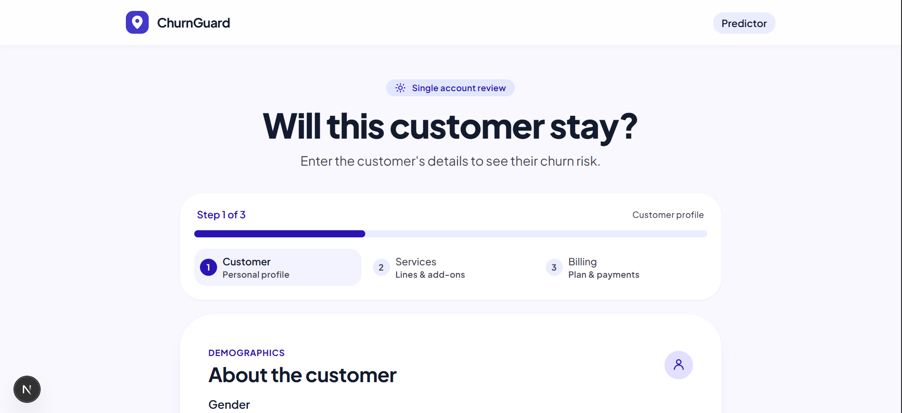

# ChurnGuard: Customer Churn Prediction

An end-to-end machine learning project that predicts whether a telecom customer is likely to leave, with a FastAPI backend and a Next.js dashboard.



## Problem

Telecom companies lose revenue when customers leave. ChurnGuard predicts which customers are at risk, so the company can contact them before they go. The model is tuned for **high recall**: it is better to flag too many customers than to miss one who will leave.

## Dataset

[Telco Customer Churn](https://www.kaggle.com/) (IBM sample data, 7,043 customers). Search "Telco Customer Churn" on Kaggle, download the CSV, and place it at `data/WA_Fn-UseC_-Telco-Customer-Churn.csv`.

## Approach

1. Preprocessing and feature engineering (`src/churnguard/prepare.py`)
2. Four models compared: Logistic Regression, Random Forest, CatBoost, XGBoost
3. Hyperparameter tuning with cross-validation (`scripts/tune.py`)
4. Final model: **CatBoost**, decision threshold **0.30**

## Results (test set)

| Model               | CV ROC-AUC | Test ROC-AUC |
| ------------------- | ---------- | ------------ |
| Logistic Regression | 0.843      | 0.856        |
| Random Forest       | 0.844      | 0.856        |
| **CatBoost**        | **0.848**  | **0.863**    |
| XGBoost             | 0.845      | 0.863        |

CatBoost at threshold 0.30: precision 0.556, recall 0.781, F1 0.65.

## Project structure

```
Telco_churn/
├── src/churnguard/   # preprocessing, training, prediction, API
├── scripts/          # tuning and manual checks
├── tests/            # automated tests
├── dashboard/        # Next.js front end
├── design/           # UI design files
├── artifacts/        # trained models
├── data/             # dataset (not committed)
├── app.py            # API entry point (used by Docker)
├── Dockerfile
└── README.md
```

## How to run

### With Docker

```bash
docker build -t churnguard .
docker run -p 8000:8000 churnguard
```

### Without Docker

```bash
pip install -r requirements.txt
uvicorn app:app --reload
```

API docs: http://127.0.0.1:8000/docs

## Example prediction

```json
{
  "prediction": "No Churn",
  "churn_probability": 0.0432,
  "churn_risk": "Low"
}
```

## Tech stack

Python, Pandas, Scikit-learn, CatBoost, XGBoost, FastAPI, Pydantic, Joblib, Pytest, Docker, Next.js, TypeScript

## Disclaimer

Educational project. Predictions are estimates, not guarantees of customer behavior.
